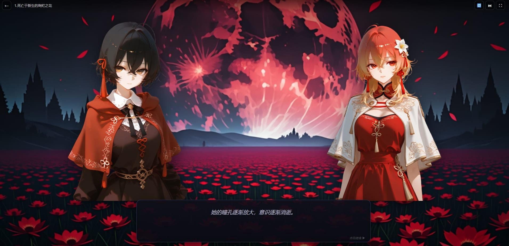
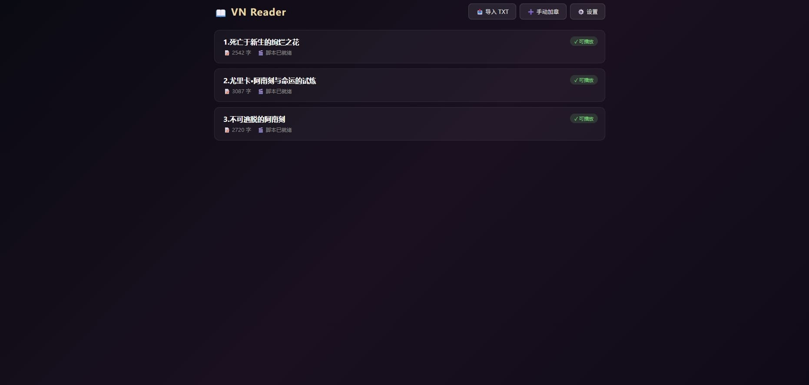
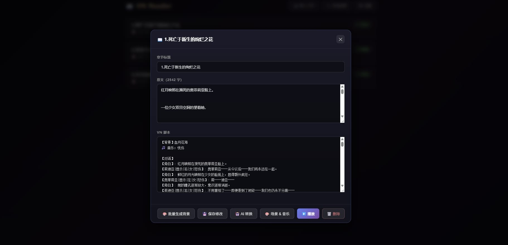
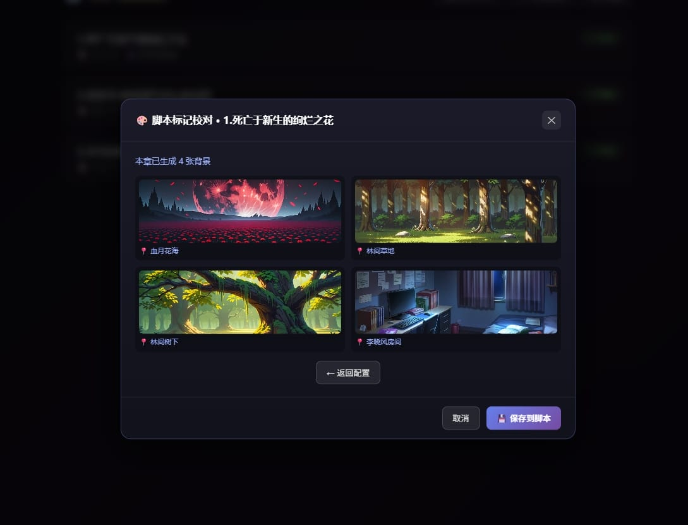

# VN Reader

一个纯前端、无构建、开箱即用的**视觉小说（VN）阅读器**。导入小说 TXT，用任意 OpenAI 兼容 API（本地或云端）将其转换为视觉小说脚本，配合立绘、背景、BGM 和 TTS 语音，把文字小说变成可点击推进的视觉小说体验。

> 所有数据保存在浏览器 `localStorage`，无需服务器、无需数据库、无需安装依赖。

---



## ✨ 功能特性

### 📖 书架与章节管理
- **TXT 导入**：自动识别「第X章 / Chapter X / 数字.」等分章格式，导入前可预览确认
- **手动加章**：直接粘贴文本创建章节
- **章节编辑**：随时修改标题、原文、VN 脚本
- **状态标识**：待转换 / 转换中 / ✓ 可播放一目了然

### 🤖 AI 脚本转换
- 兼容 **KoboldCpp、LM Studio、Ollama、OpenAI、DeepSeek** 等所有 OpenAI 格式 `/v1/chat/completions` 接口
- 把小说原文自动改写为 VN 脚本，包含：
  - **背景切换**（多场景自动识别）
  - **音乐标记**（从可配置的情绪列表中选取）
  - **对话行**（角色 / 显隐 / 位置 / 性别 / 心情）
  - **旁白**（环境描写、心理活动）
  - **选项**（分岔剧情）
- 转换前可配置音乐标记列表（内置默认/极简/丰富三套预设）
- 覆盖保护：已有脚本时需勾选确认才会重新转换

### 🎬 VN 播放器
- **打字机效果**（速度可调）
- **三槽立绘**（左 / 中 / 右），支持说话高亮、聆听变暗、鼠标悬停高亮
- **多背景淡入淡出**
- **BGM 循环播放**，音量可调
- **选项弹层**，支持 A/B/C/D 分岔
- **键盘操作**：空格 / 回车 / → 推进，Esc 退出
- **自动前进**模式（每句 2.2 秒）
- **跳过 / 重播 / 全屏**

### 🎨 立绘系统
- **专属立绘优先**：`assets/sprites/女/林青禾/开心.png` 这种结构
- **随机抽签兜底**：角色没有专属立绘时，从随机池抽一张并持久化分配
- **状态 fallback**：`开心` → `默认` → 无状态图，逐级回退
- **性别归一化**：支持「女 / female / f」等多种写法
- **玩家立绘**：`assets/sprites/玩家/player.png`，支持状态图

### 🔊 TTS 语音（可选）
- 对接 **audio.cpp** 等本地 TTS 服务（OpenAI 格式 `/v1/audio/speech`）
- **角色音色路由**：同名 `.txt` 存在 → 用专属音色；否则从 26 个音色池随机抽签并持久化
- **三层降级**：角色音色 → 性别默认音色 → narrator 默认音色
- **LRU 合成缓存**，避免重复请求
- **串行合成 + 串行播放**流水线，不卡打字机
- **BGM Ducking**：语音播放时自动降低 BGM 音量
- **等语音播完再继续**模式（可选）

### 💾 存档
- 自动保存到 `localStorage`（节流 400ms）
- 支持导出 / 导入 JSON 存档
- 一键重置全部数据

---

## 📁 目录结构

```
vn-reader/
├── index.html
├── style.css
├── js/
│   ├── state.js        # 全局状态 + 存档
│   ├── sprites.js      # 立绘管理
│   ├── vn.js           # VN 播放器（解析/打字机/背景/音乐/选项）
│   ├── api.js          # AI API 封装
│   ├── chapters.js     # 章节管理 + 模态框
│   ├── converter.js    # 章节 → VN 脚本转换
│   ├── settings.js     # 设置面板
│   ├── main.js         # 启动入口
│   └── tts/
│       ├── core.js     # TTS 引擎（缓存/请求/播放/Ducking）
│       ├── router.js   # 角色 → 音色路由
│       ├── player.js   # 串行流水线 + 三层降级
│       └── ui.js       # TTS 设置界面
└── assets/
    ├── bg/             # 背景图（按【背景】名匹配）
    ├── music/          # BGM（按 🎵 音乐 名匹配）
    ├── sprites/        # 立绘
    │   ├── 女/
    │   │   ├── 林青禾/开心.png
    │   │   ├── 林青禾/默认.png
    │   │   └── 1.png ~ 200.png   # 随机池
    │   ├── 男/
    │   │   └── ...
    │   └── 玩家/
    │       └── player.png
    └── voices/         # TTS 参考音频
        ├── narrator/default.wav (+ default.txt)
        ├── male/default.wav (+ default.txt)
        ├── female/default.wav (+ default.txt)
        └── player/default.wav (+ default.txt)
```

---

## 🚀 快速开始

### 1. 获取项目

```bash
git clone <your-repo-url>
cd vn-reader
```

或者直接下载 ZIP 解压。

### 2. 启动本地服务器

因为要用 `fetch` 加载素材，**不能用 `file://` 直接打开**，需要起个静态服务器。

**方式一：VS Code Live Server（推荐，最省事）**

1. 在 VS Code 扩展市场安装 **Live Server**（作者 Ritwick Dey）
2. 用 VS Code 打开项目根目录（含 `index.html` 的那层）
3. 右键 `index.html` → **Open with Live Server**
4. 浏览器会自动打开 `http://127.0.0.1:5500`，改代码保存后自动刷新

> 若端口被占用，Live Server 会自动顺延到 5501、5502……以地址栏实际 URL 为准。

**方式二：命令行静态服务器**

```bash
# Python 3
python -m http.server 8000

# 或 Node
npx serve .
```

浏览器打开 `http://localhost:8000`。

### 3. 配置 AI

点击书架右上角 **⚙️ 设置**：

| 字段 | 说明 | 示例 |
|---|---|---|
| API 地址 | 填到 `/v1` 之前 | `http://127.0.0.1:5001` |
| API Key | 本地模型可留空 | `sk-...` |
| 模型名 | 按后端要求填 | `koboldcpp` / `gpt-4o-mini` / `deepseek-chat` |
| Temperature | 0.7~1.0 适合剧本改编 | `0.85` |
| Max Tokens | 一章 4k~8k 通常够 | `6000` |

点 **🔗 测试连通性** 确认配置正确。

### 4. 导入小说

- **📥 导入 TXT**：选择 TXT 文件，自动分章并预览
- **➕ 手动加章**：粘贴单章文本

### 5. 转换与播放

1. 点击章节卡片打开菜单
2. 点 **🤖 AI 转换**，确认后等待 30~90 秒
3. 转换完成后点 **▶️ 播放**
4. 点击画面 / 空格键推进对话

---

## 📝 VN 脚本格式

AI 会按以下格式生成脚本（你也可以手动编辑）：

```
【背景】学校天台
🎵 音乐：宁静

【对话】
【旁白】: 夕阳把天台的铁栏杆染成橘红色。
【林青禾|显示|中|女|平静】: 你来了。
【我|显示|中|男|默认】: 嗯。你说的"重要的事"，是什么？
【林青禾|显示|中|女|紧张】: 其实……我一直想告诉你。

【背景】学校走廊
🎵 音乐：紧张
【旁白】: 夜色降临，走廊的灯一盏一盏亮起来。

【选项】
A. 逃回教室。
B. 镇定地回应他。
```


### 语法说明

| 语法 | 含义 |
|---|---|
| `【背景】名字` | 切换背景，匹配 `assets/bg/名字.{png,jpg,jpeg,webp}` |
| `🎵 音乐：名字` | 切换 BGM，匹配 `assets/music/名字.{mp3,ogg,wav,m4a}` |
| `【角色\|显示\|左/中/右\|性别\|心情】: 台词` | 角色对话 |
| `【旁白】: 内容` | 旁白（居中斜体显示） |
| `【选项】` + `A. xxx` | 选项分岔 |

- **显隐**：`显示` 或 `隐藏`（隐藏会让该槽位空出）
- **位置**：`左` / `中` / `右`
- **性别**：`男` / `女` / `未知`（影响立绘和 TTS 音色池）
- **心情**：`开心` `平静` `忧郁` `愤怒` `紧张` `惊讶` `害羞` `悲伤` `默认`，影响立绘状态图匹配

---

## 🎨 素材准备

### 背景
```
assets/bg/学校天台.png
assets/bg/深夜街道.jpg
```
脚本里写 `【背景】学校天台` 即可匹配。找不到时用设置里的 `fallbackBg` 渐变兜底。

当然，也可以用comfyui批量的对一个章节的背景进行立绘生成


### BGM
```
assets/music/宁静.mp3
assets/music/紧张.ogg
```
脚本里写 `🎵 音乐：宁静` 即可。

### 立绘

**方式一：专属立绘**（推荐，支持状态表情）
```
assets/sprites/女/林青禾/开心.png
assets/sprites/女/林青禾/默认.png
assets/sprites/女/林青禾.png          ← 无状态时兜底
```

**方式二：随机池**（角色没专属图时自动抽签）
```
assets/sprites/女/1.png ~ 200.png
assets/sprites/男/1.png ~ 200.png
```
抽签结果存进 `spriteAssignments`，重启后保持不变。

**玩家立绘**
```
assets/sprites/玩家/player.png
assets/sprites/玩家/开心.png    ← 可选状态图
```

### TTS 音色（可选）

```
assets/voices/narrator/default.wav
assets/voices/narrator/default.txt    ← 参考文本（内容 = wav 里说的话）
assets/voices/female/default.wav
assets/voices/female/default.txt
assets/voices/male/default.wav
assets/voices/male/default.txt
assets/voices/player/default.wav
assets/voices/player/default.txt
```

- **角色专属音色**：把 `林青禾.wav` + `林青禾.txt` 放到 `female/` 下，探测到 `.txt` 就会优先用
- **没有专属音色**：从 `1.wav ~ 26.wav` 池里抽签（需要你先准备好这批参考音频）

---

## 🔊 TTS 配置

1. 启动一个兼容 OpenAI `/v1/audio/speech` 的 TTS 服务，例如 [audio.cpp](https://github.com/ggml-org/audio.cpp)
2. 设置面板 → **🔊 语音（TTS）**：
   - 勾选「启用语音」
   - 填后端地址（如 `http://127.0.0.1:8080`）
   - 填模型名（如 `omnivoice`）
   - 填参考音频目录（默认 `assets/voices`）
3. 点 **🎤 测试合成** 验证
4. 播放时语音会自动合成并播放，BGM 自动压低

**调试工具**：
- 🗑️ 清缓存：清空 LRU 合成缓存
- 🔄 重置角色降级：清除"降级到 default"的标记
- 🎲 重抽所有音色：清空抽签结果，下次重新分配

---

## ⌨️ 快捷键

| 按键 | 功能 |
|---|---|
| 空格 / 回车 / → | 推进对话（打字中则立即补全） |
| Esc | 退出播放 |
| 点击画面 | 推进对话 |

---

## 🔧 技术说明

- **零依赖、零构建**：纯 HTML/CSS/JS，脚本按顺序加载
- **模块化**：state / sprites / vn / api / chapters / converter / settings / tts 分层
- **并发保护**：`API.chat` 内置 `_inflight` 锁，防止重复请求
- **打字机 Promise 化**：`advance()` 可在打字中强制 resolve，避免死等
- **立绘悬停**：因为 `pointer-events: none`，用 `mousemove` 手动算矩形命中
- **TTS 流水线**：串行合成 worker + 串行播放 + `_waitForResult` 等待机制
- **Ducking**：TTS 播放时 BGM 音量 × 0.3，结束后恢复

### 浏览器兼容

- Chrome / Edge / Safari / Firefox 现代版本
- 移动端适配（响应式布局）
- `localStorage` 需可用（隐私模式可能受限）

---

## ❓ 常见问题

**Q：导入 TXT 后中文乱码？**  
A：目前按 UTF-8 读取。GBK 文件请先转码为 UTF-8。

**Q：AI 转换失败？**  
A：先点设置里的「测试连通性」。若返回内容为空，检查 `Max Tokens` 是否太小，或换更强的模型。

**Q：立绘不显示？**  
A：检查路径是否为 `assets/sprites/女/角色名/状态.png`。性别字段要和目录名一致（男/女/默认）。打开控制台看 `[Sprites]` 日志。

**Q：BGM 不播？**  
A：浏览器要求用户交互后才能播放音频。第一次点击画面后才会解锁。

**Q：TTS 合成失败？**  
A：确认 TTS 后端已启动、`folderBase` 路径正确、`default.wav` + `default.txt` 存在。控制台会打印 `file_missing` / `reftext_missing` 等错误码。

**Q：数据会丢吗？**  
A：存在浏览器 `localStorage`。换浏览器 / 清缓存 / 隐私模式会丢。建议定期在设置里「📤 导出存档」。

---

## 📄 License

MIT

---

## 🙏 致谢

- 脚本格式灵感来自传统视觉小说引擎
- TTS 对接 [audio.cpp](https://github.com/ggml-org/audio.cpp)
- 兼容所有 OpenAI 格式 API 后端

---

**把小说变成视觉小说，只需一个 TXT。** 📖 → 🎬
